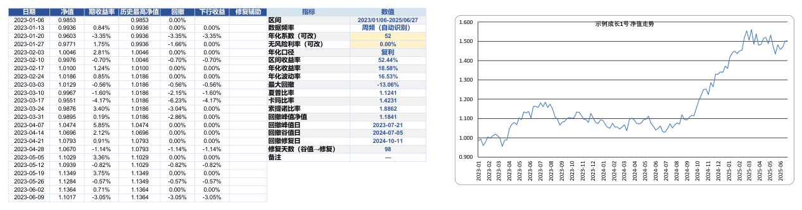
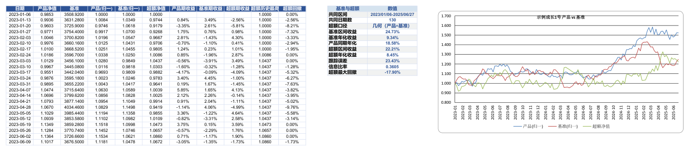

# fund-performance-eval · 基金绩效评估

> **English:** An Agent Skill (Claude Code and other Agent Skills–compatible agents) that turns fund NAV spreadsheets into performance-evaluation Excel workbooks: return, annualized return, volatility, max drawdown with recovery dates, Sharpe / Calmar / Sortino, and optional benchmark excess return, tracking error and information ratio. Every metric is written as a live Excel formula, with native line charts. Single file or whole-folder batch. Documentation is in Chinese.

把基金净值表交给 agent，说一句“算一下绩效”，就能拿到一份可以直接发给同事的绩效评估 Excel。



## 特点

- **指标全是 Excel 公式。** 区间收益、年化、波动率、最大回撤、夏普、卡玛、索提诺、回撤起止和修复天数都能点开单元格核对。汇总表引用各产品 sheet，改了净值，所有数字一起更新。
- **自动识别数据频率。** 日频、周频、月频分别用 252、52、12 年化，私募的周频净值不会把夏普算高一倍多。
- **基准与超额。** 传入一个基准文件，就能得到几何或算术超额、跟踪误差、信息比率、超额最大回撤，以及产品、基准、超额三条曲线。
- **批量处理。** 一个文件夹里的产品一次算完，另出一份汇总表。
- **不会误伤已有文件。** 输出已存在时先停下问用户；文件正被 Excel 打开时整批不写，并列出需要关闭的文件。
- **经过核对。** 测试会用真实 Excel 和 LibreOffice 重算公式，逐项对比 Python 口径。



## 安装

需要 Python 3.9+：

```bash
pip install -r requirements.txt
```

**Claude Code**：把仓库克隆到 skills 目录即可。

```bash
git clone https://github.com/<you>/fund-performance-eval ~/.claude/skills/fund-performance-eval
```

其他支持 Agent Skills 的 agent，放到它的 skills 目录下。

## 用法

对 agent 说：

- “帮我算一下 D:\data\大鹏9号原始数据.xlsx 的绩效”
- “D:\data\产品净值 这个文件夹里的基金一起评估，区间 2025 年 1 月到 6 月，用累计净值”
- “和 D:\data\沪深300.xlsx 比一下超额，无风险利率按 2%”

也可以直接用命令行：

```bash
python scripts/fund_eval.py <源 .xlsx 或文件夹> [--start 2025-01-01] [--end 2025-06-30]
       [--use-accum] [--linear] [--freq auto|daily|weekly|monthly|quarterly]
       [--rf 2%] [--benchmark 基准.xlsx] [--excess geometric|arithmetic]
       [--output-dir 目录] [--overwrite]
```

退出码：0 完成，1 出错，2 输出已存在（需要 `--overwrite`），3 输出文件被打开。

试一下示例数据（合成数据，不是真实产品）：

```bash
python examples/make_examples.py
python scripts/fund_eval.py examples/data --benchmark examples/benchmark/示例基准指数.xlsx
```

## 输入格式

第一行是列名，至少有一个日期列和一个净值列：

| 净值日期 | 单位净值 | 累计净值 |
|---|---|---|
| 2025-01-03 | 1.0030 | 1.2530 |
| 2025-01-10 | 1.0112 | 1.2612 |

- 日期列：列名含“日期”或“date”（成立日、到期日等会被排除）
- 单位净值：单位净值 / 净值 / NAV / Unit NAV
- 累计净值：列名同时含“累计/accum”和“净值/NAV”
- 基准文件：日期 + 收盘点位或净值
- 产品名取自文件名：从第一个中文字符到“X号”或“X期”，例如 `大鹏9号原始数据.xlsx` → `大鹏9号`

## 输出

| 文件 | 内容 |
|---|---|
| `<产品名>绩效评估.xlsx` | 产品 sheet：数据区 + 指标表 + 净值曲线；有基准时多一个“-基准”sheet |
| `基金汇总绩效评估.xlsx`（仅批量） | “汇总”sheet 在最前，后面是每只产品的明细 sheet |

单文件输出到源文件同目录，批量输出到 `<文件夹>/result/`。


指标口径详见 [docs/methodology.md](docs/methodology.md)。

## 开发

```bash
pip install pytest
pytest
```

`tests/test_excel_recalc.py` 需要本机有 Excel（Windows + pywin32）或 LibreOffice，都没有时自动跳过。可用 `FPE_RECALC=excel|libreoffice` 指定引擎。

## License

[MIT](LICENSE)
